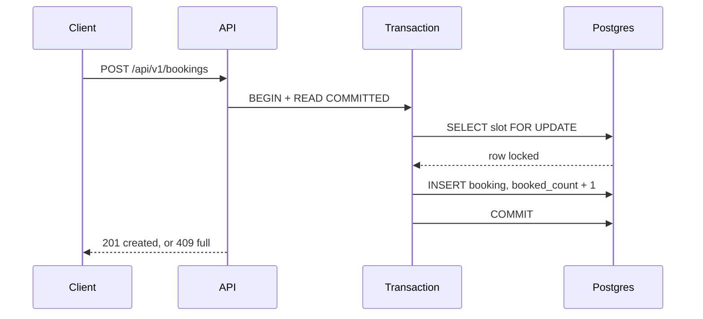

# Slotwise

[](https://github.com/alexandrahodzzik/slotwise-backend/actions/workflows/ci.yml)

Slotwise is the backend of a scheduling desk: rooms have time slots, each slot has a capacity, and a booking takes one seat. Concurrent requests are normal. The API answers 201 or 409 from a PostgreSQL transaction, not from a lock in the Python process. `SELECT … FOR UPDATE` on the slot row makes the second request wait, then read the count the first one committed. A single-page desk at `/` books through that same API.

Backend originally built at the Codaro Hackathon (Aug 2026, team project, I was the backend developer). This repository is my cleaned-up re-implementation with tests, load testing and CI.



## Quickstart

Docker, [uv](https://docs.astral.sh/uv/), and GNU make. On Windows the Makefile runs in Git Bash.

```bash
make up
make test
make bench
```

`make up` builds the API, waits until `/health` is green, and serves the desk at <http://localhost:8000>. Press **Open a demo desk** for tomorrow's North studio (Europe/Warsaw, 09:00–17:00, 30-minute slots, 3 seats). `make down` removes the containers and the volume.

## curl

```bash
curl -s http://localhost:8000/health

curl -s -X POST http://localhost:8000/api/v1/resources \
  -H 'content-type: application/json' \
  -d '{"name":"North studio","kind":"room"}'

curl -s -X POST http://localhost:8000/api/v1/resources/1/slots \
  -H 'content-type: application/json' \
  -d '{"from":"2026-11-02T09:00:00Z","to":"2026-11-02T12:00:00Z","duration_minutes":30,"capacity":3}'

curl -s "http://localhost:8000/api/v1/resources/1/availability?from=2026-11-02T09:00:00Z&to=2026-11-02T12:00:00Z"

curl -s -D - -X POST http://localhost:8000/api/v1/bookings \
  -H 'content-type: application/json' \
  -H 'Idempotency-Key: desk-1' \
  -d '{"slot_id":1,"customer_email":"ada@example.com"}'

curl -s -X POST http://localhost:8000/api/v1/bookings/1/cancel
```

Availability returns slots that overlap the window: `starts_at < to` and `ends_at > from`. `remaining` is `capacity - booked_count`. The same `Idempotency-Key` returns the original booking with HTTP 200. Errors are `application/problem+json`.

## How double-booking is prevented

`BOOKING_STRATEGY=row_lock` is the default. One transaction, named in SQL so a pooler cannot quietly upgrade it:

```sql
BEGIN;
SET TRANSACTION ISOLATION LEVEL READ COMMITTED;
SELECT id, booked_count, capacity
  FROM slots
 WHERE id = :id
   FOR UPDATE;

-- booked_count < capacity, and this email has no confirmed seat:
INSERT INTO bookings (slot_id, customer_email, status, idempotency_key)
VALUES (:id, :email, 'confirmed', :key);
UPDATE slots
   SET booked_count = booked_count + 1
 WHERE id = :id;
COMMIT;
```

READ COMMITTED alone still lets two transactions read the same count. The second `SELECT … FOR UPDATE` waits. After the first commit it sees the new count and the API returns 409. SERIALIZABLE would also reject one writer, but with a serialization error the client has to retry. The lock turns that race into a queue.

The other correct strategy, `atomic_update`, claims the seat in one statement and inserts in the same transaction:

```sql
UPDATE slots
   SET booked_count = booked_count + 1
 WHERE id = :id
   AND booked_count < capacity
RETURNING id;
```

Zero rows updated means the slot is full. A replay that lost the race is looked up by idempotency key before the 409, so a retry is 200.

`BOOKING_STRATEGY=naive` is a demo of a lost update. It is not the default. The process logs a warning when it is on. It reads the confirmed count, sleeps, and inserts if that old number was under capacity. `booked_count` is written from the stale read (`observed + 1`), not incremented in SQL, so `CHECK (booked_count BETWEEN 0 AND capacity)` stays quiet while the `bookings` table oversells the slot. The benchmark counts those rows. Do not point a real desk at it.

## Benchmarks

Confirmed bookings are counted in Postgres. `make bench` replaces this table. Nothing below is estimated.

<!-- BENCH:START -->
| strategy | confirmed bookings | overbooked by | p50 latency | p95 latency | errors |
| --- | ---: | ---: | ---: | ---: | ---: |
| row_lock | 5 | 0 | 1747.7 ms | 3515.0 ms | 0 |
| atomic_update | 5 | 0 | 1732.9 ms | 3338.5 ms | 0 |
| naive | 11 | 6 | 1681.9 ms | 3203.5 ms | 0 |
<!-- BENCH:END -->

The setup and the per-strategy `booked_count` are in [docs/BENCHMARKS.md](docs/BENCHMARKS.md). Interview notes, including what not to claim, are in [docs/INTERVIEW.md](docs/INTERVIEW.md).

## Design decisions

- **Row lock.** The waiter blocks on the slot, then reads the committed count and gets a definitive 409. The client does not retry.
- **Conditional update.** The `WHERE booked_count < capacity` clause is the claim. Postgres locks the row for that update. Same promise, different shape. The explicit lock is the default because the wait is visible in the code.
- **SERIALIZABLE.** Also correct, and worse for this API: the loser gets `40001` and must retry, and the retry can still lose. The row lock already serializes the one row that matters.
- **Optimistic version column.** `UPDATE … WHERE version = :seen` fails the loser and asks them to retry. Worth it when the read and the write are far apart. Here the decision is "is there a seat", so the retry loop is extra surface.
- **EXCLUDE.** A range exclusion fits a resource that can take one person. These slots have a capacity. Three seats at 09:00 is success. An exclusion constraint does not express "at most three".
- **CHECK.** Defense in depth. It rejects a counter outside `0..capacity`. It does not count rows in `bookings`, and without the lock a race becomes an integrity error instead of a 409.

Cancellation peeks `slot_id`, locks the slot, then locks the booking. Booking locks only the slot. The same first lock is what keeps those two paths from deadlocking. A second cancel is idempotent and does not decrement twice.

The partial unique index `(slot_id, customer_email) WHERE status = 'confirmed'` is the "already seated" rule. Emails are lowercased. A cancelled row leaves the index, so the same person can book again.

## Testing

`make test` starts Postgres 16 and runs pytest. The concurrency tests send 50 bookings at a 3-seat slot, for both `row_lock` and `atomic_update`, and expect 3×201, 47×409, `booked_count = 3`. Twenty requests with one `Idempotency-Key` expect one booking (1×201, 19×200). Two concurrent cancels must not decrement twice. Unit tests cover slot generation and do not need a database. The `naive` marker is excluded (`-m 'not naive'`). CI runs ruff, mypy on `src/`, pytest, and `docker build`. It does not run the load test.

## Limitations and next steps

There is no authentication. Anyone who can reach the API can book, and the desk trusts the email typed in the browser. A booking is one slot. Several slots in one request need a single transaction that locks those rows `ORDER BY id` before inserting, otherwise two callers can deadlock by taking the locks in opposite orders. A confirmation email does not exist yet. It should be an outbox row written in the same transaction as the booking, not a second side effect that can succeed when the booking rolls back.

## The desk

`/` is a static page served by FastAPI. No Node build. Fraunces and Manrope are self-hosted under the [SIL Open Font License](web/assets/fonts/OFL.txt). The page creates the demo day through the public API, stores the email in `localStorage`, and sends a new `Idempotency-Key` (`crypto.randomUUID()`) on every click. A 409 is shown on that hour, then availability is fetched again. Full hours stay quiet. Seats you booked in this tab can be cancelled. The footer reads the strategy from `/health`.
